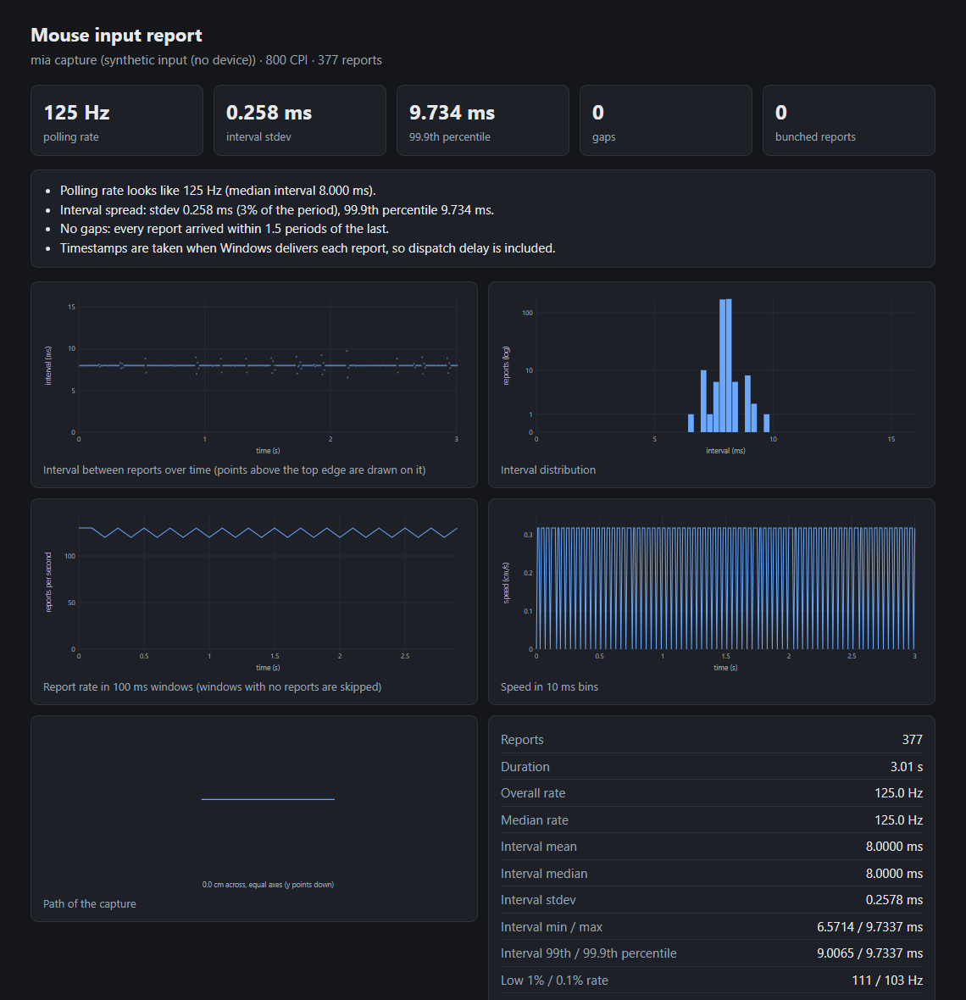

# Mouse input analyzer

Records a mouse through Windows Raw Input and measures its real polling rate, interval jitter, gaps and motion, then writes a self-contained HTML report or a CSV. For anyone who wants to check what a mouse actually delivers, and for reading captures made with MouseTester or MousePlotter.

**Status:** v0.2.0, working. USB timestamps (ETW) verified on three USB mice; physical-mouse timing numbers are not published yet (see Limits).



*The screenshot is a capture of a synthetic 125 Hz signal made with `examples/inject.rs`, not a physical mouse.*

## Features

- Locks onto one physical mouse, so a second device cannot mix into the capture.
- Stamps every report with the performance counter the moment Windows delivers it, on a time-critical thread with a 1 ms system timer.
- With administrator rights and a USB mouse, also traces the USB stack (Event Tracing for Windows) and times each report at the USB controller interrupt or transfer completion instead, which removes the scheduling delay of user-mode delivery.
- Reports polling rate, interval mean, median, stdev, min, max, 99th and 99.9th percentile, low 1% and 0.1% rate, and jitter.
- Separates a pause (hand stopped) from a gap (a report arrived late), and tells a delayed report from a lost one by looking for the catch-up burst after it.
- Motion statistics: path length, net movement, straightness, speed in cm/s, speed variation, zero-motion reports.
- Reads and writes the MouseTester CSV layout and MousePlotter's paired layout with both clocks (`eventTime`, `userTime`, `timestampSource`).
- The HTML report has no scripts and no network use, and works offline.

## How to install

Windows 10 or later and a Rust toolchain.

```sh
git clone https://github.com/r3clusionn/mouse-input-analyzer
cd mouse-input-analyzer
cargo install --path .
```

`mia analyze` also builds and runs on other platforms; `record`, `devices` and `usb-check` are Windows only. USB timestamps need an elevated (administrator) terminal.

## How to use

```sh
mia devices
mia usb-check                      # elevated: confirms USB timestamps work, no movement needed
mia record --seconds 10 --cpi 800 --out capture.csv --html report.html
mia analyze capture.csv --html report.html
```

`record` waits for the first mouse that moves, then records for `--seconds`. Move the mouse in
circles and straight strokes at varied speeds for the whole capture; pausing is fine and is not
counted against the mouse. Press Ctrl+C to stop early.

| Option | What it does |
|---|---|
| `--seconds N` | Record length after the first report (default 10). |
| `--cpi N` | Mouse CPI. Only used to convert counts to centimetres. |
| `--device` | `auto` (first to move), `any`, or a handle from `mia devices`. |
| `--usb auto\|require\|off` | USB timestamps: used when possible (default), required, or off. |
| `--out FILE` | Save the capture as CSV. |
| `--html FILE` | Write the HTML report. |
| `--pause-ms N` | Intervals longer than this are pauses. Default is the larger of 10 periods and 20 ms. |

## How it works

`WM_INPUT` messages arrive in a message-only window. The first thing the window procedure does is
read `QueryPerformanceCounter`; the report data is read after. Reports are classified by interval:
under 0.25 periods is bunched, over 1.5 periods is a gap, over the pause threshold is a pause. A gap
of `k` periods implies `k - 1` missing reports, and each one is counted as delayed if a short
interval follows it (the catch-up burst) and lost otherwise.

**USB timestamps** (`src/etw.rs`). Once the mouse is chosen, a real-time ETW session enables three
providers. USBHUB3 describes each USB device, including its configuration descriptor and device
object name; the name ties it to the Raw Input device, and the descriptor gives the HID interrupt IN
endpoint. UCX names the pipe for that endpoint and reports every completed transfer on it, one per
mouse report. USBXHCI marks the controller's interrupt and its deferred procedure call, so a
completion inside a DPC is credited with that interrupt's earlier time. Reports recorded before the
trace is ready are discarded. When recording stops, completions are matched to Raw Input reports in
order: a report that sees exactly one new completion between two others that also do is a fixed
point, and the reports between two fixed points are paired only if both sides have the same count.
Anything ambiguous keeps its Raw Input time, so the result is never worse than without the trace.
The CSV keeps both clocks and the source of every time.

Compared with the two tools this was built beside: MouseTester contributed the statistics (interval
and frequency percentiles, velocity) and the CSV layout. MousePlotter contributed the capture
practices (single locked device, time-critical thread, 1 ms timer) and the ETW method: provider and
event IDs, payload layouts and the pairing rules follow its Windows logger, reimplemented here in
Rust (MIT licence, see `THIRD_PARTY_NOTICES`).

## Limits

- Without administrator rights, or for Bluetooth, PS/2 and virtual mice, times are Raw Input
  delivery times, which include scheduling delay. `mia record` says which clock it used.
- USB timestamps were verified to the point of identifying the mouse, its endpoint and its pipe on
  three USB mice (`mia usb-check`: a Razer, a Logitech receiver and a third HID device), with no
  events lost. The pairing logic is unit-tested on constructed traces. A timed recording of a moving
  physical mouse has not been made yet, so there are no published numbers for it.
- Interrupt moderation can make the controller deliver several reports in one interrupt; those
  share one interrupt time and are counted as `shared`, so their individual arrival times are not
  resolved.
- Verified on Windows 11 with synthetic input from `SendInput` (`examples/inject.rs`), whose send
  times were checked to be on schedule (mean 0.002 ms late, slowest call 0.67 ms):
  - 125 Hz: median interval 8.000 ms, stdev 0.258 ms, no gaps.
  - 250, 500 and 1000 Hz: report counts and the mean interval are exact (for example 2001 reports in
    4.00 s at 500 Hz), but Windows delivers about one report in three one period late, in a burst. The
    same result came from a polling loop and a top-level window, so it is not the wait strategy or
    the window type. Treat synthetic input as a check of counts and low rates, not of timing.
- Timing numbers from a physical mouse have not been published yet. Run `mia record` on yours.

## Tests

`cargo test` runs 32 tests: statistics on constructed captures (perfect, jittery, lost report,
delayed report, long pause, zero motion), CSV round trips including the paired kernel layout and
both foreign formats, report generation, USB pairing (steady, batched delivery, a report missing in
user mode, interrupt versus completion choice), endpoint selection from configuration descriptors,
the ETW payload reader, and the binary against a recorded fixture.

## License

MIT (see `LICENSE`). Third-party notice for the ETW method in `THIRD_PARTY_NOTICES`.
